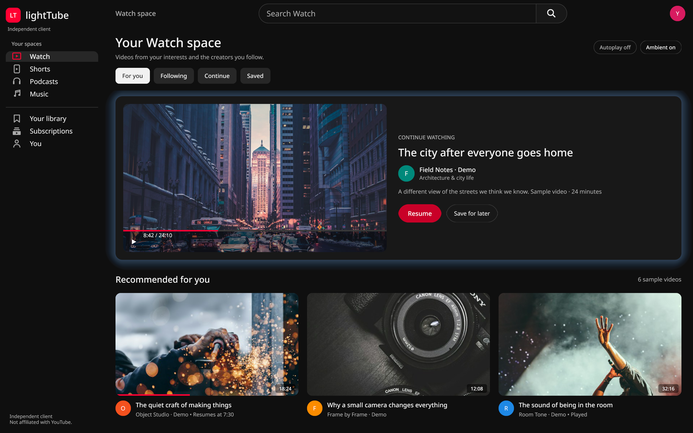
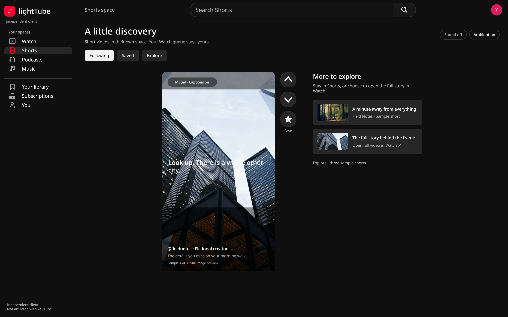
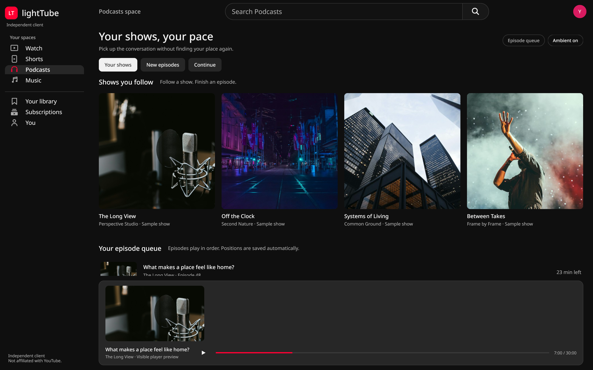
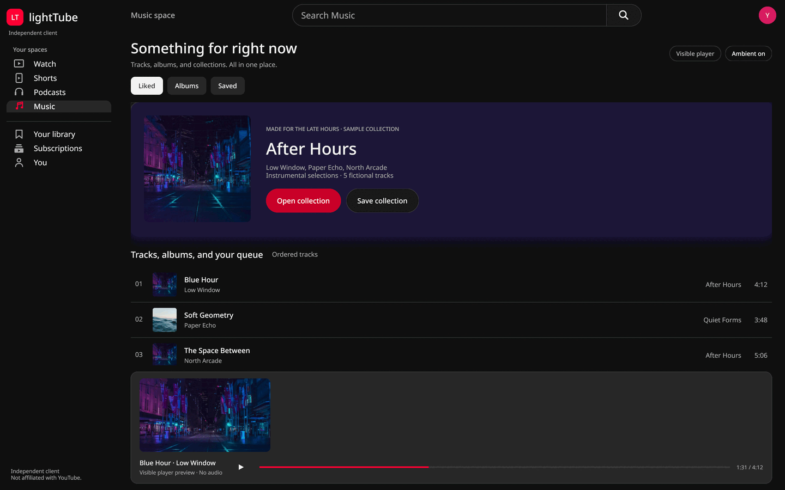

# lightTube

lightTube is a YouTube desktop client. It has four spaces: Watch, Shorts, Podcasts, and Music. It supports accounts, playlists, search typeahead, and in-window video playback on Linux. Playback can also use an external mpv window.

## Runtime requirements

- Linux: Wayland or X11, `mpv` with `libmpv.so.2`, `yt-dlp`, and the Noto Sans and Noto Sans CJK fonts (Arch: `noto-fonts`, `noto-fonts-cjk`).
- macOS: `libmpv` and `yt-dlp` from Homebrew. The app uses an external mpv window.
- Windows: `yt-dlp.exe` on `PATH`. Add `mpv-2.dll` beside `lighttube.exe` for in-window playback.
- Account sign-in reads a browser session through yt-dlp. Cookies stay on the local device. yt-dlp reads the saved cookie file for account feeds and playback.

## Install

### Linux tarball

Download and extract the Linux x86_64 archive from [Releases](https://github.com/i3wangyi/lightTube/releases). Run:

```sh
./install.sh
```

The installer uses `~/.local` by default. Set `PREFIX` to choose another prefix. Run `PREFIX="$HOME/.local" ./install.sh --uninstall` to remove the installed files.

### Arch Linux

Download `packaging/arch/PKGBUILD` and `packaging/arch/.SRCINFO` from the source tree. From that directory, run `makepkg -si`.

### Build from source

Install Go 1.27 through mise and the Gio, Wayland, EGL, X11, fontconfig, and mpv development libraries. Then run:

```sh
make build
make install
```

`make install` installs under `~/.local` by default. Use `make install PREFIX=/usr/local` to select another prefix. Run `make check` to run formatting, vet, and Go tests.

### macOS app

Download and unzip the macOS arm64 app archive from [Releases](https://github.com/i3wangyi/lightTube/releases). Install the runtime libraries:

```sh
brew install mpv yt-dlp
```

The app is unsigned. On first open, Control-click `lightTube.app`, select **Open**, then confirm **Open** in the dialog. macOS can block a direct double-click because the app is unsigned. Playback opens in external mpv.

### Windows zip

Download and unzip the Windows x86_64 archive from [Releases](https://github.com/i3wangyi/lightTube/releases). Install `yt-dlp.exe` and add it to `PATH`. For in-window playback, place `mpv-2.dll` beside `lighttube.exe`. Install mpv for external playback.

## Features

- Four spaces: Watch, Shorts, Podcasts, and Music.
- Local account support with YouTube feeds, saved playlists, and watch history.
- Search suggestions while typing.
- In-window playback on supported Linux systems; external mpv playback on all platforms.
- Local channel subscriptions and Watch later list.

## Keyboard shortcuts

| Shortcut | Action |
| --- | --- |
| `Alt+1` to `Alt+4` | Switch between the four spaces |
| `Ctrl+1` to `Ctrl+5` | Switch tabs |
| `Ctrl+L` | Focus search |
| `Ctrl+V` | Paste and play a YouTube URL |
| `Enter` | Search or play the selected item |
| `Space` or `K` | Play or pause |
| `J` / `L` | Seek backward / forward 10 seconds |
| `Left` / `Right` | Seek backward / forward 5 seconds |
| `M` | Mute or unmute |
| `F` | Toggle fullscreen |
| `Esc` | Exit fullscreen or close the watch page |
| `O` | Open the current video in external mpv |

## Hyprland Integration

For Omarchy Hyprland users (using Lua configuration), `contrib/hyprland.lua` provides keybindings and window rules:

```lua
-- Unbind Omarchy default YouTube web app shortcut.
hl.unbind("SUPER + SHIFT + Y")

-- Bind Super+Shift+Y to focus or launch lightTube.
o.bind("SUPER + SHIFT + Y", "lightTube", o.launch_sole("lighttube", "lighttube"))

-- Window rule for external mpv player window (app id: lighttube-mpv).
o.window("^lighttube-mpv$", { float = true, size = { 1280, 720 }, center = true })
```

To load this configuration:
1. Copy or symlink `contrib/hyprland.lua` to `~/.config/hypr/lighttube.lua` and add `require("lighttube")` in `~/.config/hypr/hyprland.lua`, or
2. Paste the snippet directly into `~/.config/hypr/bindings.lua`.

## Command line

- `lighttube [--external-player] [--debug]`:
  Launch the graphical interface. `--external-player` opens video playback in an external mpv window rather than using the embedded player. `--debug` enables verbose logging.
  `--demo` starts with built-in sample data: no account, no network and no playback.
  `--demo --space <watch|shorts|podcasts|music> --render-png WxH out.png` renders one screen to a PNG without opening a window.
  `--debug-sequence <steps>` is a developer tool that runs UI steps (for example `music:play,wait:8`) through the normal click handlers.
- `lighttube play <url> [--audio]`:
  Play a video directly from URL. `--audio` plays audio only with format `ba`.
- `lighttube search <query>`:
  Search YouTube videos and output results (`ID`, `Title`, `Channel`, `Duration`).
- `lighttube feed [--account home|subs|later|history]`:
  Without `--account`, output the merged feed of local subscriptions. With `--account`, output the signed-in YouTube feed (`home`, `subs`, `later`, or `history`).
- `lighttube account <signin|signout|status|list|switch <id>|remove <id>>`:
  - `signin`: Read YouTube cookies from the active account's browser profile.
  - `signout`: Delete the active account's saved cookies.
  - `status`: Show whether the active account is signed in.
  - `list`, `switch <id>`, `remove <id>`: Manage several accounts.
- `lighttube sub <add|list>`:
  - `lighttube sub add <url|@handle|UC id>`: Resolve channel and add to local subscriptions.
  - `lighttube sub list`: Print local subscriptions (`ChannelID`, `Title`, `URL`).
- `lighttube doctor`:
  Run environment diagnostics (mpv, libmpv, yt-dlp, JS runtime, GPU decode capabilities, settings, and login status).
- `lighttube --version`:
  Print lightTube version.

## Settings and Codec Policy

Preferences are stored in `~/.local/share/lighttube/settings.json`:
- `codec_policy`:
  - `auto` (default): Selects best video codec matching detected GPU decode capabilities (AV1 when supported, VP9 when supported, always H.264/AVC1 fallback).
  - `old-gpu`: Forces H.264 (`avc1`) with VA-API hardware decoding on Linux.
  - `any`: Best video up to 1080p of any codec.
  - On battery power, maximum height is capped lower across all policies.
- `player`: `inplace` (embedded libmpv subsurface) or `external` (separate mpv window). CLI `--external-player` overrides this setting.
- `browser_spec`: Browser spec string passed to yt-dlp for cookie extraction (default `chrome+gnomekeyring`).

Settings can be changed graphically on the "You" page (Ctrl+5).

## Account and Data Storage

Authentication uses a browser login session on the machine through yt-dlp. There is no OAuth sign-in and no API key.
- You can add several Google accounts on the You page: sign in through an isolated browser profile, or pick an existing Chrome, Chromium, Brave, Edge or Firefox profile. Switch, sign out or remove accounts there or with `lighttube account list|switch|remove`.
- Sign-in extracts session cookies with `yt-dlp --cookies-from-browser <browser>`; the default on Linux is `chrome+gnomekeyring`.
- Storage locations:
  - `~/.local/share/lighttube/settings.json`: Application configuration.
  - `~/.local/share/lighttube/cookies.txt`: Netscape cookie file, written with file mode `0600` (readable only by the owner). Cookie values are never logged or printed.
  - `~/.local/share/lighttube/subscriptions.json`: Local channel subscriptions.
  - `~/.local/share/lighttube/watchlater.json`: Saved watch later items.
  - `~/.local/share/lighttube/history.json`: Video playback history (up to 500 items).
- Cache locations:
  - `~/.cache/lighttube/thumbs/<id>.jpg`: Cached video thumbnails.
  - `~/.cache/lighttube/feeds/<channel_id>.xml`: Cached RSS feeds (15-minute TTL).
  - `~/.cache/lighttube/account/<kind>.json`: Cached account feeds.

## Performance

Measured on a MacBookPro12,1 (Intel Broadwell, Iris 6100) in October 2026, signed in, window 1200x760 at scale 2:
- The GPU decodes H.264 only, so lightTube asks for H.264 up to 1080p.
- 1080p30 playback in the window: about 15% of one CPU core (`hwdec-current=vaapi`).
  External mpv: about 20%. The same video in Google Chrome: about 95%.
- Startup to first frame: about 60 to 200 ms.
- Idle CPU with the window open: about 0%. The window draws only on events.
- Memory (RSS) 25 s after start, with thumbnails drawn: about 100 to 112 MiB
  (demo mode: about 90 MiB). The target in SPEC.md is 128 MB.

## Platform Support

| Platform | In-Window Playback | External Player | Status |
| --- | --- | --- | --- |
| Linux (Wayland) | Supported (subsurface) | Supported | In-window, tested |
| Linux (X11) | Supported (X11 child window) | Supported | In-window, tested under Xwayland |
| Windows | Written, never run (Win32 child window, needs `mpv-2.dll`; the child window may block the main window, see `internal/embed/embed_windows.go`) | Written, never run | Builds in CI only |
| macOS | No (falls back to external mpv) | Written, never run | Builds in CI only |

### macOS Note

On macOS, playback uses the external mpv player. The release has an unsigned `lightTube.app`; in-window playback on macOS is not written yet.

## Known Limits

- No emoji font: Renders Latin and CJK characters using system Noto fonts, but emoji glyphs are not displayed.
- YouTube Music is not directly supported by yt-dlp. The Music space uses YouTube Music playlist and search endpoints, which can change upstream.
- YouTube offers this app no Shorts recommendation feed. The Shorts space shows Shorts from followed channels and Shorts search.
- In windows narrower than about 600 dp, the Podcasts and Music player dock takes most of the height.
- The Windows and macOS builds are packaged by CI but have not been run by the author.

## Privacy and affiliation

lightTube is not affiliated with YouTube. Cookies stay on your device. yt-dlp reads them to access account feeds and play account-restricted content. lightTube does not print cookie values.

## Demo screenshots

These screenshots use demo data only. They do not show live YouTube content. Stock photo sources are listed in [internal/demo/ASSETS.md](internal/demo/ASSETS.md).

| Watch | Shorts |
| --- | --- |
|  |  |

| Podcasts | Music |
| --- | --- |
|  |  |

## License

lightTube is licensed under the GNU General Public License, version 3 or later. See [LICENSE](LICENSE).
